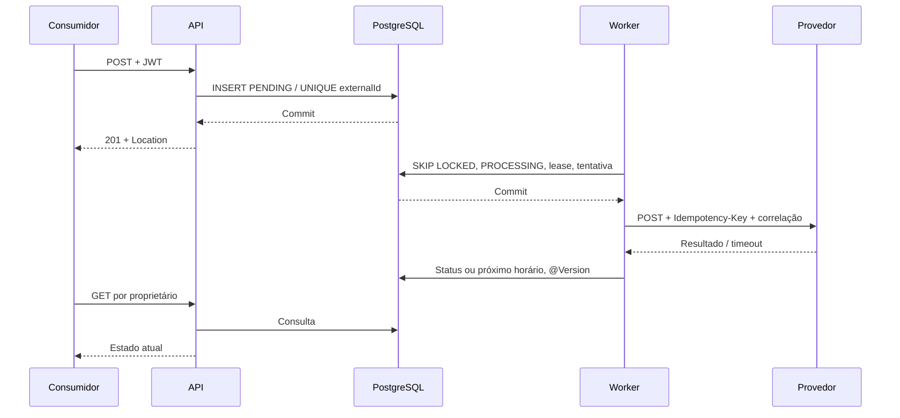

# Product Activation Service

Desenvolvi esta solução para o desafio Java Pleno/Sênior: API de solicitações de ativação com processamento assíncrono, idempotência, segurança OAuth 2.0/JWT e recuperação de falhas.

Java 21 · Spring Boot 3.5.16 · Spring MVC/Data JPA · PostgreSQL 17 · Flyway · Gradle 8.14.3.

## Como executar

Pré-requisitos: Docker Engine/Desktop com Compose v2. Para build fora do contêiner: JDK 21 em `JAVA_HOME`. Não precisa instalar Gradle.

```sh
docker compose up --build -d
docker compose ps
```

O Compose sobe aplicação (`localhost:8080`), PostgreSQL (`localhost:5432`) e mock do provedor/emissor local (`localhost:8081`). Portas publicadas apenas no loopback. Aguarde o health check da aplicação. Credenciais locais são deliberadamente demonstrativas; não usar esse Compose em produção.

O perfil `demo`, ativo por padrão no Compose, carrega **100 solicitações variadas** por migration: quatro consumidores, dez clientes, dez produtos e os quatro estados. Veja [a carga inicial e o roteiro de cenários](docs/demo-data.md), incluindo como pausar o worker e testar replay, isolamento, retries e leases vencidos.

Exemplo completo em PowerShell:

```powershell
$token = (Invoke-RestMethod -Method Post http://localhost:8081/dev/token `
  -ContentType 'application/json' -Body '{"consumerId":"sistema-a"}').access_token
$headers = @{ Authorization = "Bearer $token"; 'X-Correlation-ID' = 'demo-001' }
$request = Invoke-RestMethod -Method Post http://localhost:8080/api/v1/requests `
  -Headers $headers -ContentType 'application/json' `
  -Body '{"externalId":"EXT-12345","customerId":"CUST-10001","productCode":"INTERNET-500"}'
Invoke-RestMethod "http://localhost:8080/api/v1/requests/$($request.id)" -Headers $headers
Invoke-RestMethod 'http://localhost:8080/api/v1/requests?status=COMPLETED&customerId=CUST-10001&page=0&size=20' -Headers $headers
```

O token expira em uma hora. O mock gera chaves RSA efêmeras ao iniciar; após reiniciá-lo, obtenha novo token e reinicie a aplicação para invalidar o cache JWKS local. `/dev/token` **não existe na aplicação** e não representa um servidor OAuth de produção.

Para executar a aplicação no host:

```sh
docker compose up -d database provider
./gradlew bootRun
```

No Windows use `./gradlew.bat bootRun`. Os defaults já apontam para as portas locais. Para parar, `docker compose down`; dados persistem no volume. `docker compose down -v` também apaga o banco local.

Consulte o [guia de testes com curl e PowerShell](docs/manual-tests.md) para validar sucesso, falhas, retries, concorrência, autenticação e isolamento.

## Build e testes

```sh
./gradlew clean build
```

Windows: `./gradlew.bat clean build`. Relatórios: `build/reports/tests/test/index.html` e `build/reports/jacoco/test/html/index.html`. JAR executável: `build/libs/product-activation-service-1.0.0.jar`.

O build exige JDK 21. `gradle.properties` usa a codificação nativa do launcher para suportar classpaths com acentos no Windows; fontes Java são sempre compiladas como UTF-8. A versão de Gradle foi alinhada à [compatibilidade oficial do Spring Boot 3.5](https://docs.spring.io/spring-boot/3.5/system-requirements.html).

| Camada | Evidência e propósito |
| --- | --- |
| Domínio, sem Spring | Transições inválidas, estados terminais, elegibilidade de retry |
| Worker, Mockito | Sucesso, falha permanente, timeout/retry, limite de tentativas, jitter |
| HTTP real em loopback | 2xx, 400, 500, 429, Retry-After em segundos/data, timeout de leitura e chave de idempotência |
| API + H2 | Validação, persistência, 201/Location, replay 200, conflito 409, consultas/filtros, paginação, isolamento, 401/403 e 413 |
| JWT assinado + JWKS local | Assinatura, issuer, audience, subject, exp e rejeição de token adulterado |
| Filtro de admissão | 429, Retry-After e correlação |
| PostgreSQL/Testcontainers | 12 criações concorrentes com um vencedor; workers concorrentes; ausência de transação durante HTTP; recuperação de lease e esgotamento |
| ArchUnit | Domínio independente de Spring e das camadas superiores; aplicação independente dos adaptadores |

Os testes PostgreSQL são pulados quando Docker está indisponível, sem substituir sua evidência por H2. **A CI verifica Docker e falha se os testes PostgreSQL forem pulados.** H2 serve para testes rápidos de API; não comprova semântica de locks do PostgreSQL.

Mantenho os resultados de verificações anteriores no [relatório de revisão](docs/code-review.md); eles não substituem uma nova execução no ambiente de entrega. Para um smoke test manual, execute `python3 dev/smoke.py` contra o Compose sem o perfil demo: ele verifica criação, replay, conclusão, falha permanente e recuperação de timeout com JWT real. Consulte também [a matriz de requisitos](docs/requirements.md).

## Contrato HTTP

Todos os endpoints `/api/v1/requests` exigem Bearer JWT.

| Operação | Escopo | Resposta |
| --- | --- | --- |
| `POST /api/v1/requests` | `requests.write` | 201 + Location; 200 em replay; 409 em conflito |
| `GET /api/v1/requests/{id}` | `requests.read` | 200; 404 se inexistente ou de outro consumidor |
| `GET /api/v1/requests` | `requests.read` | Envelope paginado `content/page/size/totalElements/totalPages` |

POST recebe `externalId`, `customerId`, `productCode`. Todos são obrigatórios, sem espaços, alfabeto `[A-Za-z0-9._:-]+`; limites respectivos 100/100/64 caracteres. São case-sensitive. A API não remove espaços silenciosamente. Datas são `Instant` em UTC/ISO-8601; DTOs separados da entidade. O POST responde com o snapshot PENDING gravado, mesmo que o worker já tenha avançado no momento em que a resposta chegue ao cliente.

Filtros opcionais: `status` e `customerId`; `page` começa em 0; `size` entre 1 e 100, default 20. Ordenação estável por createdAt e id descendentes. Paginação offset pode deslocar itens sob novas inserções; cursor é uma evolução para grandes volumes.

Erros seguem Problem Details, com `status`, `title`, `detail`, `instance`, `traceId` e, na validação de corpo, `errors`. A resposta propaga `X-Correlation-ID` sanitizado ou gera um novo UUID. Não inclui stack trace, mensagens SQL, resposta bruta do provedor nem credenciais. Erros remotos assíncronos aparecem no recurso como `failureCode` e estado; não se transforma falha posterior do provedor em erro do POST já aceito.

## Decisões técnicas

Os contratos são declarados em arquivos próprios: `api.dto.request` contém entradas HTTP, `api.dto.response` contém respostas, `exceptions` reúne exceções da aplicação e `application.result` contém os resultados do serviço e do provedor. A camada de aplicação não depende dos DTOs HTTP. As exceções são traduzidas em respostas HTTP por `exceptions.handler.ApiExceptionHandler`; `api.error.ApiProblemFactory` constrói o contrato compartilhado com os filtros.

Veja [ADR de processamento](docs/adr/0001-persisted-async-processing.md), [ADR de idempotência/segurança](docs/adr/0002-idempotency-and-security.md) e [ADR de arquitetura](docs/adr/0003-architecture-and-observability.md).

### Duplicidade e concorrência

`external_id` tem UNIQUE **global** no banco. Consultar antes de inserir melhora o caminho de replay, mas não garante unicidade: duas transações podem observar ausência simultaneamente. A restrição resolve a corrida; o perdedor lê o vencedor após rollback da sua transação.

Mesmo externalId, mesmo consumidor e mesmo conteúdo retornam 200 com o recurso atual. Outro conteúdo ou consumidor retornam 409 genérico. Duas chamadas idênticas simultâneas resultam em um 201 e demais 200. Nenhum replay dispara um novo trabalho. Registros terminais são imutáveis pelo fluxo e continuam disponíveis para deduplicação.

### Processamento e resiliência



| Retorno | Novo estado | Nova tentativa |
| --- | --- | --- |
| 2xx | COMPLETED | Não; assumo que 2xx confirma ativação conforme o enunciado |
| 400 e demais 4xx, exceto 429 | FAILED | Não; corrigir contrato/credencial/dados antes de intervenção |
| 500 e demais 5xx | PROCESSING; FAILED no limite | Sim, backoff exponencial com jitter |
| Timeout/falha de conexão | PROCESSING; FAILED no limite | Sim, mesma chave de idempotência; resultado remoto pode ser ambíguo |
| 429 / 503 | PROCESSING; FAILED no limite | Sim, respeita maior valor entre backoff e Retry-After |
| Redirecionamento 3xx | FAILED | Não segue redirecionamentos para não enviar credenciais a outro destino |

No máximo 5 tentativas por padrão, incluindo tentativas interrompidas por queda. Backoff entre 50% e 100% de 1s, 2s, 4s etc., teto 60s. Retry-After aceita segundos e data HTTP, limitado a 24h para evitar retenção ilimitada por resposta defeituosa; valor inválido usa backoff. A última falha fica em `failureCode`, inclusive durante espera; COMPLETED pode preservar a falha anterior para indicar histórico de retry.

A tabela é a fila durável; nenhuma tarefa depende de evento somente em memória. O worker reivindica uma linha por transação curta e faz HTTP **fora** da transação. Após queda, o lease vencido permite retomar. Contador de tentativa e `@Version` impedem resultado de worker antigo de sobrescrever o atual. Uma chamada por vez por instância limita concorrência; o polling default é 500ms depois de cada ciclo. Isso favorece simplicidade e previsibilidade, não vazão máxima.

Não existe garantia unilateral de exactly-once: o provedor deve armazenar a chave de idempotência pelo período acordado e responder ao replay sem repetir o efeito. O mock simula essa condição em memória, incluindo `TIMEOUT` após efetivar a ativação. Em produção, FAILED após timeout demanda reconciliação pelo identificador original. A justificativa para não adicionar circuit breaker agora e a estratégia para introduzi-lo estão no ADR 0001.

### Índices

UNIQUE externalId garante integridade e replay. `(status,next_attempt_at,lease_until)` apoia seleção de trabalho; índices com consumerId e createdAt/id apoiam a listagem isolada. Variantes com status ou customerId cobrem os filtros comuns. Para filtro combinado, PostgreSQL pode usar o índice mais seletivo e filtrar o restante. Validar com `EXPLAIN (ANALYZE, BUFFERS)` e dados representativos antes de adicionar índice de todas as combinações: cada índice encarece escrita, vacuum e armazenamento.

### Segurança

Produção usa OAuth 2.0 **Client Credentials**, adequado a sistemas sem usuário interativo. Um IdP externo autentica o cliente e emite access token; o serviço é somente Resource Server. JWT: assinatura RS256 via JWKS, emissor exato, audiência `activation-api`, exp obrigatória, validade temporal/nbf e `sub` obrigatório. `sub` deve ser estável e exclusivo por sistema nesse issuer. Escopos de leitura e escrita são distintos; possuir escrita não implica leitura. Consulta por UUID e listagem sempre filtram proprietário.

Credencial do provedor entra por `PROVIDER_TOKEN`, nunca no código/log. Em cloud, usar secret manager/Vault com identidade da workload, mínimo privilégio e injeção via ambiente/arquivo. Rotação: aceitar sobreposição curta de credenciais, renovar secret e fazer rolling restart; o cliente atual lê a credencial ao iniciar. JWKS permite rotação de chaves públicas pelo IdP. Usar TLS para IdP, API, banco e provedor em produção; HTTP está restrito ao ambiente local.

Corpo limitado a 8KiB, inclusive chunked; 120 chamadas/minuto/IP/instância, mapa de no máximo 10 mil IPs por janela. Retorna 413 ou 429 com Retry-After. É proteção local básica: atrás de proxy, vários consumidores podem compartilhar IP. Quota global por cliente e proteção contra slow uploads devem ficar no gateway confiável. CSRF desabilitado porque a autenticação é stateless com Bearer header, sem sessão/cookie; não há CORS permissivo.

## Observabilidade

- Os eventos da aplicação usam campos estruturados no JSON: `request_created`, `request_replayed`, `request_idempotency_conflict`, `activation_started`, `provider_call_finished`, `activation_retry_planned` e `activation_processed`. Filtre por `correlationId` para acompanhar o POST e o processamento posterior, ou por `requestId` para acompanhar uma solicitação entre tentativas. `activation_processed` registra o estado após o commit; `activation_retry_planned` indica uma decisão ainda dentro da transação.
- Para troubleshooting, examine `attempt`, `failureCode`, `durationMs`, `retryDelayMs` e `nextAttemptAt`. `activation_stale_result_ignored` indica resposta de uma tentativa ultrapassada e `activation_attempt_limit_reached` indica esgotamento. Eventos de erro incluem o tipo e frames da exceção, sem sua mensagem ou cadeia de causas, que podem conter SQL, payloads ou credenciais. Falhas de conexão do provedor incluem também `causeType`.
- O nível padrão é INFO; use `APP_LOG_LEVEL=DEBUG` para diagnóstico adicional, como recuperação de inserção concorrente. No Compose, acompanhe a saída com `docker compose logs -f`. Lombok fornece `@Slf4j` nos componentes de processamento e `@RequiredArgsConstructor` no serviço; as transições da entidade continuam explícitas.
- Liveness: `/actuator/health/liveness`; readiness: `/actuator/health/readiness`, incluindo banco. O provedor não entra na readiness: sua queda não deve impedir registrar solicitações na fila.
- `/actuator/prometheus` exige `metrics.read`. Métricas incluem `http_server_requests_seconds`, `activation_provider_duration_seconds`, `activation_provider_calls_total`, `activation_requests` por status e `activation_transitions_total`.
- Logs estruturados JSON com correlationId, requestId interno, estado e tentativa. Sem payloads, tokens ou credenciais.
- OpenTelemetry via Micrometer exporta spans HTTP por OTLP. Configure collector e amostragem; veja a limitação do contexto assíncrono no ADR 0003. Um collector não é incluído no Compose básico.

As métricas de quantidade por estado são atualizadas a cada 30s e representam o banco inteiro. Em várias réplicas, agregue por `max`, não por soma. Alertas sugeridos: idade do trabalho mais antigo (evolução), crescimento de PROCESSING/FAILED, p95/p99 de API/provedor, esgotamento do pool e taxa de timeout. Um scrape inicial pode mostrar zero até a primeira atualização.

## Cenário de análise de produção

API de 300ms para 2,5s, queries de 50ms para 1,2s e provedor de 400ms para 3s, com CPU 45% e memória 60%, sugerem espera por I/O/contenção; médias de CPU/memória não excluem picos ou saturação por instância.

1. Eu confirmaria janela, endpoints afetados, p50/p95/p99, volume, distribuição por instância e alterações recentes. Correlacionar deploy/configuração, tráfego e dependências antes de alterar capacidade.
2. Eu usaria traces para separar tempo na API, espera por conexão, execução SQL e HTTP externo. Medir Hikari active/idle/pending/timeouts, threads/filas, GC/pausas, conexões HTTP e latência DNS/rede. CorrelationId liga POST e trabalho posterior.
3. No banco, eu verificaria locks/deadlocks, transações longas, `pg_stat_activity`, `pg_stat_statements`, slow queries, plano/estatísticas, buffers, IOPS e crescimento de dados. Comparar SQL real e parâmetros anonimizados. Não presumir que todo atraso SQL é falta de índice.
4. Na integração, eu separaria connect/TTFB/leitura, taxa de timeout, 429/5xx e tentativas. Verificar se retries ampliaram tráfego. Não aumentar timeout automaticamente: isso pode reter mais recursos.

**Hipótese de causa comum:** uma implementação que mantém transações abertas durante HTTP lento segura conexões/locks por mais tempo, satura o pool, aumenta espera de outras queries e degrada a API. Confirmaria cruzando spans HTTP com duração de transação, conexões ocupadas e `idle in transaction`, além de reproduzir com latência injetada. Esta solução evita esse acoplamento. Outra hipótese é rede/NAT/IO do host compartilhado; comparar métricas e sondas das mesmas rotas com instâncias saudáveis.

Melhorias dependem da evidência: índice/plano, reduzir N+1 e volume retornado, transações menores, pool dimensionado pela capacidade real do banco, HTTP com timeouts, fila durável, concorrência limitada, backoff/circuit breaker. Escalar pods sem medir pode apenas multiplicar conexões e retries.

**Após publicar:** canary com rollback definido, comparar p95/p99 e throughput sob carga equivalente, manter taxa de erros e correção dos resultados, observar locks/pool/backlog e drenagem da fila. Executar testes de carga e falhas (delay/500/queda durante processamento), confirmar uma ativação lógica por chave e acompanhar mais de uma janela de pico. CPU menor isoladamente não comprova correção.

## Produção e cloud

Dockerfile usa build em múltiplos estágios, runtime JRE 21, usuário não-root, health check e limite de heap relativo à memória do contêiner. Há shutdown gracioso, janela de 30s e Compose com 40s de tolerância. Lease e idempotência cobrem interrupção que exceda essa janela. Usar imagem imutável por digest e scan de vulnerabilidades no release.

| Variável | Default/local | Finalidade |
| --- | --- | --- |
| `DB_URL`, `DB_USER`, `DB_PASSWORD` | PostgreSQL localhost / activation | Banco e credenciais |
| `PROVIDER_URL`, `PROVIDER_TOKEN` | localhost:8081 / vazio | Endpoint e credencial externa |
| `PROVIDER_CONNECT_TIMEOUT`, `PROVIDER_READ_TIMEOUT` | 2s / 5s | Limites HTTP |
| `JWT_ISSUER`, `JWT_JWK_SET_URI`, `JWT_AUDIENCE` | Emissor local / activation-api | Validação JWT |
| `WORKER_ENABLED`, `WORKER_MAX_ATTEMPTS`, `WORKER_LEASE` | true / 5 / 30s | Processamento |
| `ACTIVATION_WORKER_POLL_MS` | 500 | Intervalo entre ciclos |
| `ACTIVATION_API_MAX_BODY_BYTES` | 8192 | Limite de corpo |
| `ACTIVATION_API_REQUESTS_PER_MINUTE` | 120 | Quota local |
| `OTEL_EXPORTER_OTLP_TRACES_ENDPOINT` | localhost:4318/v1/traces | Collector OTLP HTTP |
| `TRACING_SAMPLE_RATE` | 0.1 | Amostragem de traces |

Em cloud: banco gerenciado com backup/PITR, rede privada e TLS; configurações por ambiente, segredos no secret manager, limites de CPU/memória, probes e rolling deploy. Rodar várias instâncias é seguro para unicidade/claims graças ao banco compartilhado, SKIP LOCKED e versionamento. Relógios dos nós precisam estar sincronizados. Não usar banco independente por réplica.

Para notificar outros microsserviços, gravar evento em **transactional outbox** na mesma transação de COMPLETED e publicar em broker por relay com deduplicação no consumidor. Publicar diretamente depois do commit cria outra janela de perda. Essa notificação não é exigida no fluxo atual.

CI atual: **build/testes (incluindo PostgreSQL real) → relatórios JaCoCo → aprovação humana obrigatória para merge**. O workflow não sobe a aplicação nem cria imagens. A revisão é exigida por ruleset do GitHub; há um modelo pronto para importar. Consulte [a configuração da CI](docs/ci.md) para ativar a proteção de branch. Essas configurações remotas não são ativadas apenas por versionar os arquivos.

Evolução de CD: imagem, scan/SBOM, assinatura e push para registry, aprovação de ambiente, migrations compatíveis, canary, smoke test e rollback da aplicação. Migrations destrutivas exigem expand/contract; rollback de binário não desfaz dados automaticamente.

## Pontos pendentes e melhorias futuras

- Manterei a execução dos testes PostgreSQL e dos cenários HTTP em cada release. Consulte o [guia de testes manuais](docs/manual-tests.md) e o [relatório da revisão](docs/code-review.md).
- Provedor e emissor locais são mocks: idempotência em memória não sobrevive a reinício. Contrato real precisa de deduplicação durável, prazo de retenção e consulta/reconciliação de resultado remoto.
- Circuit breaker, outbox de eventos, quotas distribuídas e rastreamento do contexto pai através da fila estão descritos nos ADRs, sem infraestrutura extra no desafio.
- FAILED é terminal automaticamente. Uma futura operação administrativa de reconciliação precisa de escopo próprio, auditoria e consulta ao provedor; não expor reset livre de estado.
- Para grande volume, priorizarei: retenção/arquivamento sem perder a janela de idempotência, paginação por cursor, métricas de idade/backlog, processamento paralelo limitado, carga representativa e índices ajustados por plano real.
- Para preparar a produção, implementarei: secrets obrigatórios por profile, TLS/mTLS quando apropriado, policy de egress, limites no ingress, dashboards/alertas, backup/restore ensaiado e revisão de dependências.

## Uso de IA

Utilizei OpenAI Codex para interpretar o enunciado e cobrir possíveis pontos pendentes, estruturar a solução e infraestrutura, implementar testes, elaborar ADRs e documentação. Registrei as decisões, limitações e evidências para revisão técnica.
